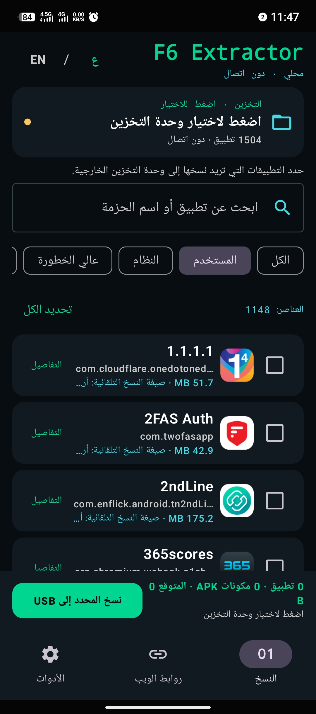
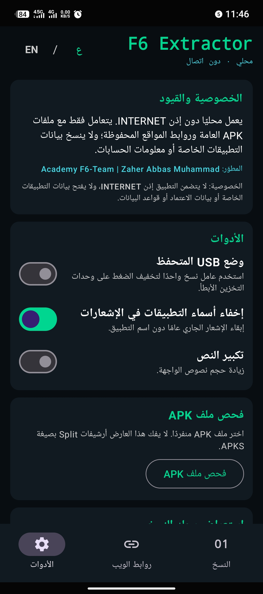
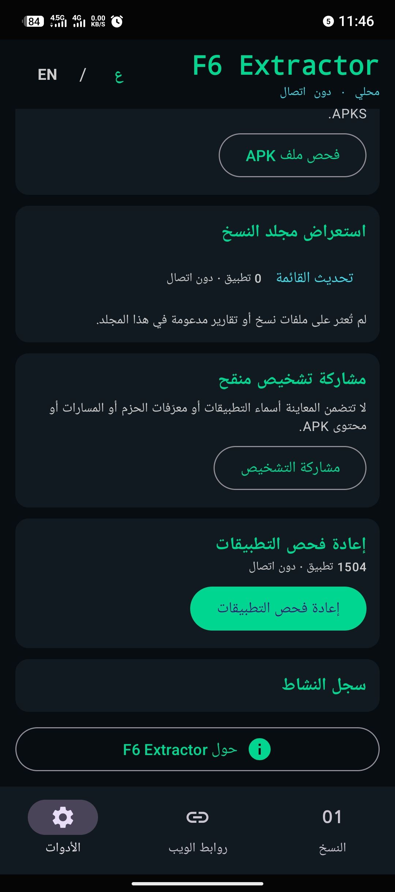
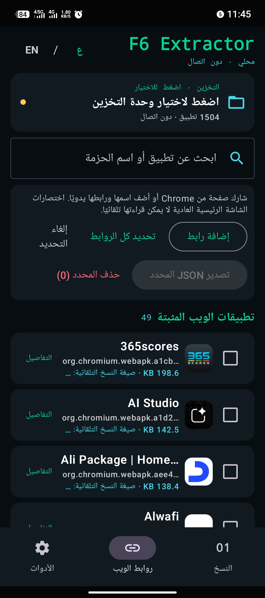
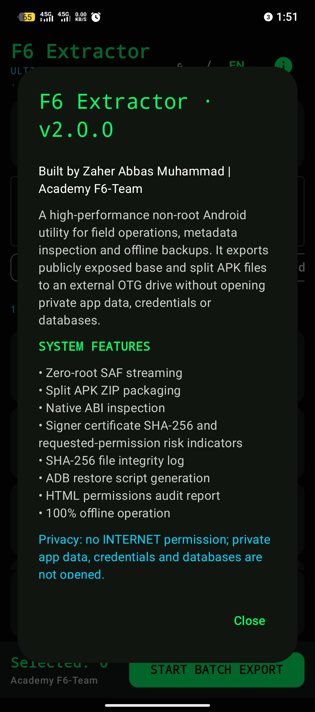

# 📦 F6 Extractor
**أداة أندرويد عالية الأداء لاستخراج، نسخ، وفحص التطبيقات بدون صلاحيات الجذر (Root)**

---

## 📝 عن التطبيق
**F6 Extractor** هو أداة متقدمة لنظام Android صُممت للعمليات الميدانية، فحص البيانات الوصفية (Metadata)، والنسخ الاحتياطي للتطبيقات. يتميز التطبيق بقدرته على العمل محلياً بالكامل دون الحاجة لاتصال بالإنترنت أو صلاحيات الروت، مما يضمن أعلى مستويات الخصوصية والأمان.

> 🛡️ **الخصوصية أولاً:** التطبيق لا يتضمن إذن `INTERNET`، ولا يفتح بيانات التطبيقات، ولا ينسخ بيانات الاعتماد أو قواعد البيانات.

---

## ✨ المميزات الرئيسية
*   🚀 **استخراج التطبيقات:** نسخ وتصدير ملفات APK و APKS بسهولة إلى وحدة تخزين خارجية (USB) أو الذاكرة الداخلية.
*   🔓 **دعم SAF:** تدفق بيانات آمن (Storage Access Framework) دون الحاجة لصلاحيات الجذر.
*   ⚙️ **تحديد ذكي:** اختيار تلقائي بين ملفات APK و APKS بناءً على مكونات التطبيق.
*   🔍 **فحص APK:** أداة مدمجة لفحص ملفات APK المفردة، وعرض بصمة شهادة التوقيع ومؤشرات الأذونات المطلوبة.
*   🌐 **تطبيقات الويب:** حفظ وإدارة روابط المواقع المشتركة (Web Links) وتصديرها بصيغة JSON.
*   📦 **إدارة النسخ:** معاينة دفعة النسخ، الوسوم، وأسماء الملفات دون استبدال الموجود منها.
*   🔄 **استقرار الأداء:** إعادة محاولة النسخ الفاشل، إيقاف حراري مؤقت لإصدارات Android المدعومة، ووضع USB متحفظ لتقليل الضغط على الوحدات.
*   🕵️ **تسجيل آمن:** سجل سلامة SHA-256 وتقارير محلية متكاملة.

---

## 📸 لقطات الشاشة

  
### واجهة النسخ الرئيسية

### أدوات الفحص والإعدادات

### إدارة تطبيقات الويب (Web Links)

### معلومات التطبيق والمطور

---

## 🚀 كيفية الاستخدام
1. **نسخ التطبيقات:** من الشاشة الرئيسية، حدد التطبيقات التي ترغب بنسخها، اختر وحدة التخزين (يفضل USB)، ثم اضغط على **"نسخ المحدد إلى USB"**.
2. **فحص ملف APK:** اذهب إلى تبويب **"الأدوات"** واضغط على **"فحص ملف APK"** لاختيار أي ملف وعرض تفاصيله الأمنية.
3. **إدارة الروابط:** من تبويب **"روابط الويب"**، يمكنك إضافة روابط Chrome، تحديدها، وتصديرها كملف JSON.

---

## 👨‍💻 المطور
**Zaher Abbas Muhammad** 
*   Academy F6-Team
*   الإصدار الحالي: `2.4.0`

---

  
**إذا أعجبك التطبيق، لا تنسَ وضع نجمة ⭐ للمستودع!**

